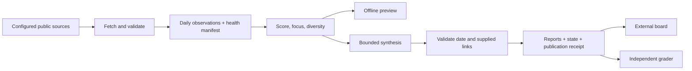

# AI Radar

A daily AI briefing built from source observations, explicit ranking, and a bounded
synthesis step. Collect research, model releases, engineering tools, and hardware
news; keep the useful evidence; publish a short, linked digest.

[Read the briefing](https://amaljithkuttamath.github.io/radar/) · [Markdown digest](reports/latest.md) · [Report archive](reports/README.md) ·
[Independent evaluation](evals/latest.json)

The board lives in a separate repository. This repository owns collection,
ranking, synthesis, publication artifacts, publication receipts, and prompt experiments.

## Pipeline health

<!-- health:start -->

| signal | status | detail |
|---|---|---|
| [Daily digest](https://github.com/amaljithkuttamath/ai-radar/blob/main/reports/latest.md) | 🟢 ok | last digest committed 3h ago |
| [Model synthesis](https://github.com/amaljithkuttamath/ai-radar/blob/main/reports/latest.md) | 🟢 ok | latest digest carries model synthesis |
| [Eval loop](https://github.com/amaljithkuttamath/ai-radar/blob/main/evals/latest.json) | 🟡 warn | grader last committed 3h ago · tier 0 only, no model judgement |
| [Self-healing loop](https://github.com/amaljithkuttamath/ai-radar/issues?q=is%3Aissue+is%3Aopen+label%3Awatchdog) | 🟢 ok | no unanswered alarms |
| [Collect corpus](https://github.com/amaljithkuttamath/ai-radar/actions/runs/40919241769) | 🟢 ok | last run success |
| [Distill digest](https://github.com/amaljithkuttamath/ai-radar/actions/runs/40919346661) | 🟢 ok | last run success |
| [Watchdog](https://github.com/amaljithkuttamath/ai-radar/actions/runs/40945257209) | 🟢 ok | last run success |

Generated 2026-10-29 20:41 UTC by `scripts/health.py`.

<!-- health:end -->

## Start in one minute

Requires Python 3.10+ and [uv](https://docs.astral.sh/uv/), on macOS or Linux.

```bash
uv sync --locked
uv run python -m radar demo
```

The demo needs no credentials or network. It creates clearly synthetic inputs and
a readable preview in `data/demo/<run>/data/previews/`. It never changes published
reports, the observation ledger, or movers state.

```bash
uv run python -m radar --help
uv run python -m radar doctor
```

`doctor` reads local artifacts and reports missing, stale, invalid, and degraded
states. It exits 1 when attention is needed. A new checkout can legitimately have
no collection manifest because that manifest travels with a CI artifact.

## Collect, preview, publish

```bash
# Fetch configured public sources. No model calls.
uv run python -m radar collect --window 48h

# Read a deterministic preview. No model calls or publication.
uv run python -m radar distill --backend template

# Inspect the exact synthesis prompt without calling a model.
uv run python -m radar distill --backend dryrun

# Generate and validate a real digest using your configured credentials.
export RADAR_LLM_BASE_URL=https://openrouter.ai/api/v1
export RADAR_LLM_API_KEY=...  # load from your secret manager
uv run python -m radar distill --backend auto

# The complete collection → publication cycle.
uv run python -m radar run --backend auto --window 48h --focus agents,evals
```

Production selects `auto`: the configured shared OpenAI-compatible provider,
Anthropic, or a visibly deterministic fallback if no provider is available.
Set `RADAR_LLM_BASE_URL`, `RADAR_LLM_API_KEY`, and optionally
`RADAR_SYNTHESIS_MODEL`; the shared `llm.py` also serves the independent grader
with a different model family. Explicit `openai`, `anthropic`, and `ollama`
backends remain available. The retired `github` alias redirects to `auto`.
Local runs default to `dryrun`; scheduled CI selects `auto`.

Explicit `template` and `dryrun` always write under `data/previews/`. They never update
`reports/latest.md`, history, publication metadata, or movers state. Real runs
refuse missing/stale/incomplete corpus artifacts and empty candidate sets. Use the
same `--window` for collection and distillation; a manifest cannot be relabelled
as a different collection window.

Use `--root` before the command to isolate runtime data while reusing this repo's
configuration and prompts:

```bash
uv run python -m radar --root /tmp/my-radar run --backend template
```

The old shell entry points still work and delegate to the same CLI:
`scripts/collect.sh`, `scripts/distill.sh`, and `scripts/run.sh`.

## How it works



- **Observations, not permanent suppression.** The same item can be fetched again
  tomorrow. Its current measurements refresh, missing artifact links are retained
  within a day's observation, and readers select the newest observation per ID.
  `data/seen.json` is an informational ID ledger; it never discards fresh data.
- **Honest source health.** Each collector records per-source outcomes. Partial
  outages yield a degraded manifest and a notice in the published report. Total
  collection failure stops the pipeline. Empty results and failed requests differ.
- **Deterministic ranking.** Five observable criteria produce a score from 0 to 5.
  Focus affects ordering within a score tier. Category reservations backfill unused
  capacity; near-duplicate titles and repeated sources are limited.
- **Publication boundary.** Model output needs the requested date, nonempty text,
  source links, and URLs present in its input. Individual writes use atomic
  replacement. Handled publication/index failures restore the prior report/state
  bundle. A local lock prevents overlapping CLI writers.
- **Independent evaluation.** Structural validation cannot prove every prose
  claim. The `grader/` package runs independently: deterministic checks run in
  CI, while the separately scheduled model judge uses a different model family.

## Configuration

Precedence is **CLI → environment → `config/routines.yaml` → built-in defaults**
for the common CLI settings. Invalid configuration fails before collection starts.

| File | Purpose |
| --- | --- |
| `config/sources.yaml` | arXiv categories, HF papers enablement, lab feeds, GitHub topics |
| `config/routines.yaml` | Enabled collectors, lookback, item cap, routing threshold, enrichment |
| `config/profile.yaml` | Interest terms, aliases, and muted topics |
| `config/broken_sources.yaml` | Blocked domains, enforced when writing and reading observations |
| `distill/digest.md` | Evidence and writing contract for the synthesis model |

Common overrides: `WINDOW`, `MAX_ITEMS`, `INCLUDE_THRESHOLD`, `FOCUS`, `MARKET`,
`RADAR_MODEL_BACKEND`, `RADAR_HOME`, and `RADAR_CONFIG_DIR`. `FOCUS=""` explicitly
disables profile matching. Lookback is limited to 31 days in the CLI.

Optional `RADAR_AGENT=on` enables item briefs. Matching and clustering use lexical
methods; the old embedding endpoint is retired (ADR-0006). Template and dryrun previews
force lexical matching/clustering and skip enrichment, even if those options are set.

Email is an explicit delivery step, separate from publication:
`uv run python -m distill.deliver`. Configure the `RADAR_EMAIL_TO` and
`RADAR_SMTP_*` variables described in that module. The CLI never sends email.

## Automation

- `collect-corpus.yml` runs daily at **11:00 UTC**. It uploads observations and
  `collection.json` together as `corpus-raw`, then commits the ID ledger.
- `distill.yml` reacts to a successful collection on `main`. Manual runs accept a
  collection run ID or retrieve the latest successful `main` collection. Both paths
  validate freshness and manifest completeness before synthesis.
- Real runs commit reports, movers state, the tracking ledger, and `data/publication.json`. Previews are
  uploaded as artifacts. Heartbeats follow successful real publication only.
- Manual workflow dispatch can explicitly enable email after publication.
- `guard.yml` checks the existing scheduled-agent write scopes and runs lint,
  formatting, tests, and the offline demo on Python 3.10 and 3.13.
- `eval-deterministic.yml` evaluates published digests; `health.yml` records pipeline health.
- `watchdog.yml` continues to monitor the independent evaluation artifact.

## Development

The canonical reader lives at [amaljithkuttamath.github.io/radar/](https://amaljithkuttamath.github.io/radar/)
in the [personal-site repository](https://github.com/amaljithkuttamath/amaljithkuttamath.github.io).
It reads this repository's public reports, evidence, and publication receipts.

`site/` keeps previous `/ai-radar/` links working with a small redirect, including
archive and dated-edition links. Run `npm test --prefix site` with Node 24.
The independent Pages workflow deploys only the redirect assets; publication
failures remain separate from pipeline health reporting.

```bash
uv sync --locked
uv run pytest -q
uv run ruff check radar collectors distill tests scripts/check_whitelist.py
uv run ruff format --check radar collectors distill tests scripts/check_whitelist.py
```

Tests use temporary runtime directories and replace network/model calls at their
boundaries. They cover fresh-checkout collection, repeated observations, malformed
input, transport retries, failed sources, safe previews, link validation, rollback,
configuration, daily state, prompt experiments, and the agent whitelist.

```text
radar/       CLI, configuration, transport, orchestration, health, atomic writes
collectors/  source adapters and validated observation storage
distill/     ranking, focus, diversity, synthesis, optional enrichment and replay
grader/      independent evaluation, provenance, forecasts, and trusted metrics
llm.py       shared provider transport and model-family resolution
config/      source registry and personal preferences
tests/       offline behavior and integration tests
reports/     published Markdown and navigable archive
evals/       independent rubric, results, and backlog
docs/        architecture, migration notes, and operating contracts
```

Prompt experiments remain available through
`uv run python -m distill.evolution run --case <replay.json> --judge-backend anthropic`.
They record evidence and never automatically replace the production prompt.
See [the experiment guide](docs/evolution.md).

See [architecture and failure behavior](docs/architecture.md) and
[the v0.2 migration notes](docs/overhaul-2026-10-24.md).
