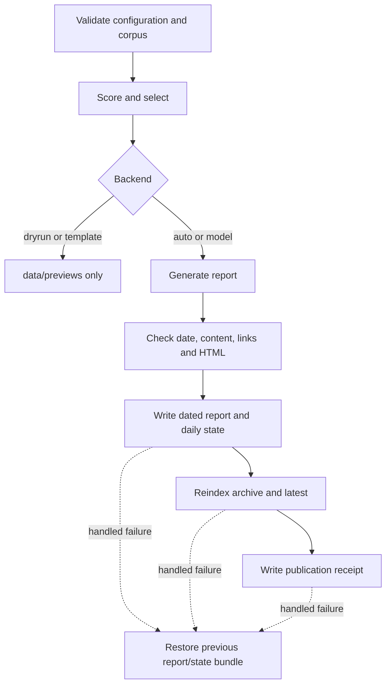

# AI Radar architecture

The runtime is a small Python application with five source adapters and one
publication boundary. The public Astro board is external. The in-repo `grader/`
package executes separately from collection and synthesis: deterministic checks
run in CI and the model judge runs on its own schedule and model family.

## Entry point and configuration

`python -m radar` exposes `collect`, `distill`, `run`, `doctor`, and `demo`.
The shell scripts are compatibility wrappers. `radar/config.py` loads routines,
validates the source/profile configuration, and applies common CLI/environment
settings before importing collector or synthesis modules.

Runtime data lives under the repository by default. `--root` / `RADAR_HOME`
isolates it; `RADAR_CONFIG_DIR` independently selects configuration. Prompts remain
versioned with the source checkout. The supported runtime is Python 3.10+ on
macOS/Linux; local writer exclusion uses `flock`.

## Collection

Adapters are fixed in a registry: HF papers, arXiv, lab RSS/Atom, GitHub Search,
and HF trending models/datasets. Config selects which adapters and sources run.
There is no dynamic plugin execution from configuration.

`radar/http.py` bounds responses to 8 MiB by default, uses a 30-second request
timeout, and retries transient HTTP/network failures up to three attempts. Backoff
and numeric Retry-After delays are capped. Permanent HTTP errors propagate.
RSS is fetched through the same transport before feedparser parses the bytes.

`SourceBatch` accounts for each configured source request. A successful empty
response counts as success. If every attempted source fails, the adapter raises.
The coordinator continues other adapters and writes `data/collection.json` even
when the whole collection fails. A fully failed collection exits nonzero.

Every accepted item has a nonempty ID/title/source, one of three categories, an
HTTP(S) primary URL, an aware fetch timestamp, and finite nonnegative signals.
Artifact links, authors, and keywords also have checked shapes. Blocked domains
are filtered both on ingress and on corpus reads. Invalid rows are logged.

The collector upserts daily observations under
`data/raw/<category>/<UTC date>/<hashed ID>.json`. Same-day measurements replace
older measurements while missing links and signals survive cross-source merges.
Readers select the newest valid observation per ID in the requested window.
The historical `seen.json` list is informational, never a reason to discard a new
observation. This is essential when CI restores the ledger without yesterday's
raw artifact.

The collection manifest records source health, timestamps, window, and exact
accepted item IDs. CI transfers the manifest and observations together. Distill
rejects failed/stale manifests, mismatched windows, and incomplete corpora. Direct local collection
modules remain supported; without a manifest, publication records collection
health as `unverified` rather than inventing a successful collection status.

## Ranking and synthesis

Scoring uses five observed criteria: known organization attribution, a concrete
result claim, an artifact, community traction, and stronger community traction.
The score is bounded to 0–5 and remains unchanged by the model. It is a ranking
heuristic, not proof of truth or quality. Static counts do not measure velocity.

Focus terms and aliases reorder within score tiers. Lexical matching and
clustering are the defaults. The old embedding endpoint is retired (ADR-0006). Candidate
selection applies diversity across the full eligible pool, reserves category
coverage, and backfills unused slots before truncation.

The synthesis prompt contains bounded item summaries, observed timestamps,
primary/secondary links, movers, and optional clusters. The final candidate array
has an explicit marker, so deterministic previews do not try to recover JSON
using a greedy regular expression. Optional briefs are used only when enabled
and fresh. Enrichment writes scored/enriched artifacts, never collector-owned raw
observations.

The model is instructed to treat source text as data, preserve scores, distinguish
observed-at from published-at, and ground links and claims in the supplied input.
It cannot actually widen a collection window; the prompt no longer tells it to.

Tracking re-observes the bounded ledger before synthesis and supplies carryover
candidates without replacing fresh collected IDs. Publication failures restore the
ledger along with the report and snapshot. Successful publication promotes new
trackable items. The shared `llm.py` provider retains payload shrinking, reasoning
output rejection, grounded story arcs, and visibly degraded fallback behavior.

`auto` may publish a deterministic fallback; an explicitly requested `template`
remains an unpublished preview. This distinguishes operational continuity from a
local inspection command.

## Publication

A real run refuses an empty candidate set. Validation rejects empty output,
incorrect report dates, raw HTML, missing source links, and unsupported link
URLs. This is structural validation: the independent grader still assesses the
meaning and truth of prose. It is not a complete Markdown security sanitizer;
the external board must continue to sanitize rendered content.

`atomic_text` uses a sibling temporary file, fsync, and atomic replacement.
Publication snapshots the prior Markdown/state/tracking/receipt files and restores them
if a handled error occurs. This is not a multi-file filesystem transaction:
a machine/power failure between replacements can still require recovery. CI
publishes the complete group in one Git commit, which is the public visibility
boundary. Readers of a local working directory should wait for the CLI to exit.

`state.json` retains its ID-keyed layout for compatibility. `last_seen` is additive.
Reruns on the same UTC day replace that day's history entry without increasing the
streak. Missing days reset consecutive-day streaks. `publication.json` records
backend, publication time, report path, SHA-256, corpus count, and collection health.

Explicit preview backends cannot write publication files or advance state. Reindexing
ignores dryrun headers and filenames whose report date does not match. Optional
email is separate and runs after successful Git publication when explicitly
requested by a manual CI run.

## State ownership

| Artifact | Writer | Persistence |
| --- | --- | --- |
| `data/raw/**` | Collection | Local, CI corpus artifact |
| `data/seen.json` | Collection | Git, informational ledger |
| `data/collection.json` | Collection | Local, CI corpus artifact |
| `data/scored/**`, `data/enriched/**` | Distillation | Regenerable local cache |
| `data/previews/**`, `data/demo/**` | Preview/demo | Local or CI evidence artifact |
| `reports/**` | Real publication | Git |
| `data/state.json`, `data/tracked.json`, `data/publication.json` | Real publication | Git |
| `data/evolution/**` | Replay capture/experiments | Local or CI evidence artifact |
| `evals/**` | Independent grader | Git, separate operating contract |

## CI boundaries

Collection and distillation retain separate concurrency groups and disjoint Git
write sets. Both checkout `main`. `workflow_run` requires a successful same-repo
collection on `main`; manual run IDs are checked against workflow path, branch,
repository, and conclusion before downloading artifacts. Cross-run download uses
`actions: read` as required by the
[official download-artifact action](https://github.com/actions/download-artifact#download-artifacts-from-other-workflow-runs-or-repositories).

`publish.sh` stages its owned artifacts, commits, then rebases and pushes. A failed
rebase is an error. Push races have a bounded retry; there is no force push.
Preview runs never invoke Git publication or the publication heartbeat.

`guard.yml` retains the scheduled-agent whitelist check and adds a Python
3.10/3.13 matrix for lint, formatting, offline tests, and demo execution. The old
monolithic manual workflow was removed to eliminate a second writer path.

## Failure behavior

| Failure | Result |
| --- | --- |
| One source unavailable | Degraded manifest; other sources continue; report includes a notice |
| All enabled collectors fail | Failed manifest; nonzero exit; existing publication untouched |
| No eligible observations | Nonzero exit for distillation; existing publication untouched |
| Expired/missing corpus artifact | CI stops before synthesis |
| Invalid configuration | CLI exits 2 before collection |
| Permanent provider failure or unusable answer | Visible deterministic fallback; transient failures still stop the run |
| Date/link/HTML validation failure | No publication; existing digest remains authoritative |
| Index/state/receipt error | Handled errors restore previous publication files |
| Replay capture failure | Warning; validated publication may complete |
| Independent grader stops | Existing watchdog checks evaluation artifact freshness |

`doctor` is read-only and local. It checks digest/evaluation dates, collection
health/age, and required credential presence without printing credential values.
It does not make network probes or promise that a provider is available.
