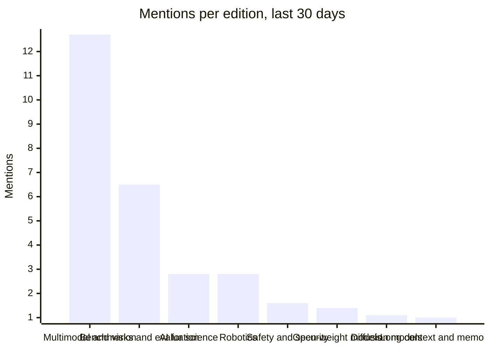

# AI Radar

What changed in AI, in plain words.

[Yesterday](../README.md) · [This week](week.md) · **This month**

## The last 30 days · Sun 25 Oct to Mon 23 Nov

### Stories with staying power

- **[nvidia/simready-assets (HF Dataset)](https://huggingface.co/datasets/nvidia/simready-assets)** CC-BY-4.0 simulation-ready 3D assets with 625k downloads; useful for robotics and synthetic data pipelines. · 14 editions, first seen Tue 27 Oct
- **[deepseek-ai/DeepSeek-V4.1-Flash-1017 (HF Model)](https://huggingface.co/deepseek-ai/DeepSeek-V4.1-Flash-1017)** image-text-to-text model (MIT) with 105k downloads; recent release for fast multimodal inference. · 11 editions, first seen Tue 27 Oct
- **[microsoft/ML-For-Beginners](https://github.com/microsoft/ML-For-Beginners)** 12-week, 26-lesson classic ML curriculum with 52 quizzes. · 4 editions, first seen Sun 1 Nov
- **[secemp9/arxiv-complete](https://huggingface.co/datasets/secemp9/arxiv-complete)** A large-scale arXiv dataset (100M–1B tokens, Parquet) tagged for text generation and retrieval tasks. · 5 editions, first seen Sat 31 Oct
- **[WeVisOne-VL](https://arxiv.org/abs/2610.31329)** Unified VLM for object- and pixel-level perception (detection, segmentation, OCR, counting, matting). · 5 editions, first seen Wed 28 Oct
- **[Intrinsic Distribution Matching](https://arxiv.org/abs/2610.39633)** decomposes reverse-KL into Gaussian moment component and non-Gaussian residual; improves few-step text-to-image generation. · 4 editions, first seen Fri 30 Oct

### Where attention moved

How often each topic came up per daily edition, this month against the month before (28 editions against 23). Counted from the digests' wording, so read it as direction, not exact size.

| Topic | Last 30 days | Before | Trend |
|---|---:|---:|---|
| Long context and memory | 1.0 | 4.8 | Down 77% |
| Safety and security | 1.6 | 0.5 | Up 3.0x |
| Benchmarks and evaluation | 6.5 | 14.5 | Down 54% |
| Diffusion models | 1.1 | 2.3 | Down 52% |
| Open-weight models | 1.4 | 0.7 | Up 2.0x |
| AI for science | 2.8 | 1.6 | Up 1.7x |
| Robotics | 2.8 | 1.7 | Up 1.6x |
| Multimodal and vision | 12.7 | 18.2 | Steady |

[All 28 editions this month, and every one before](README.md)
