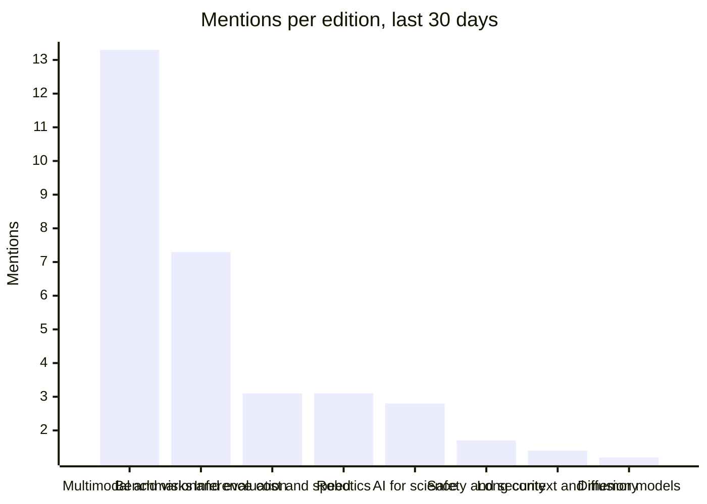

# AI Radar

What changed in AI, in plain words.

[Yesterday](../README.md) · [This week](week.md) · **This month**

## The last 30 days · Thu 29 Oct to Fri 27 Nov

### Stories with staying power

- **[microsoft/ML-For-Beginners](https://github.com/microsoft/ML-For-Beginners)** 12-week, 26-lesson classic ML curriculum with 52 quizzes. · 4 editions, first seen Sun 1 Nov
- **[secemp9/arxiv-complete](https://huggingface.co/datasets/secemp9/arxiv-complete)** A large-scale arXiv dataset (100M–1B tokens, Parquet) tagged for text generation and retrieval tasks. · 5 editions, first seen Sat 31 Oct
- **[Intrinsic Distribution Matching](https://arxiv.org/abs/2610.39633)** decomposes reverse-KL into Gaussian moment component and non-Gaussian residual; improves few-step text-to-image generation. · 4 editions, first seen Fri 30 Oct
- **[Vyber07/cyber-security](https://huggingface.co/datasets/Vyber07/cyber-security)** Text-generation/qa dataset (Apache-2.0, <1k examples). · 3 editions, first seen Fri 6 Nov
- **[Improving and Expanding Video Editing Capabilities Without Videos](https://arxiv.org/abs/2611.34941)** HorizonWind2004 proposed Image-to-Video Transfer (I2VT), which post-trains a video editor on single images using an image editor as teacher — no paired video data required. · 2 editions, first seen Thu 26 Nov
- **[Mixture-of-Loops Transformer](https://arxiv.org/abs/2611.34923)** HUST researchers introduced MoLT, a looped Transformer that passes keys and values as memory across loops via Mixture-of-Loops Attention, offering two modes: residual-stream reuse… · 2 editions, first seen Thu 26 Nov

### Where attention moved

How often each topic came up per daily edition, this month against the month before (29 editions against 22). Counted from the digests' wording, so read it as direction, not exact size.

| Topic | Last 30 days | Before | Trend |
|---|---:|---:|---|
| Long context and memory | 1.4 | 4.4 | Down 67% |
| Safety and security | 1.7 | 0.5 | Up 2.9x |
| AI for science | 2.8 | 1.2 | Up 2.2x |
| Benchmarks and evaluation | 7.3 | 14.6 | Down 50% |
| Diffusion models | 1.2 | 2.1 | Down 42% |
| Inference cost and speed | 3.1 | 4.6 | Steady |
| Multimodal and vision | 13.3 | 18.9 | Steady |
| Robotics | 3.1 | 2.2 | Steady |

[All 29 editions this month, and every one before](README.md)
