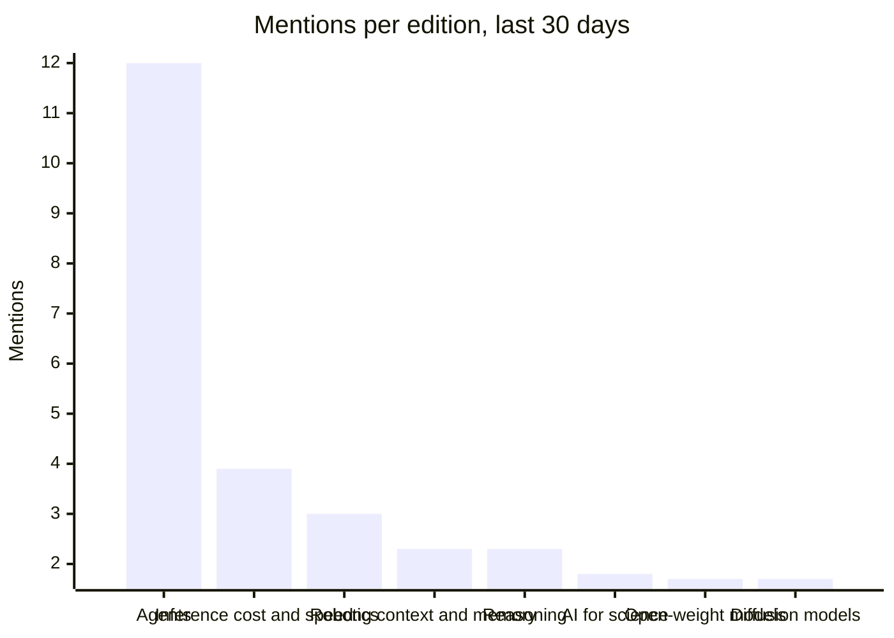

# AI Radar

What changed in AI, in plain words.

[Yesterday](../README.md) · [This week](week.md) · **This month**

## The last 30 days · Fri 9 Oct to Sat 7 Nov

### Stories with staying power

- **[nvidia/simready-assets (HF Dataset)](https://huggingface.co/datasets/nvidia/simready-assets)** CC-BY-4.0 simulation-ready 3D assets with 625k downloads; useful for robotics and synthetic data pipelines. · 12 editions, first seen Tue 27 Oct
- **[huggingface/transformers](https://github.com/huggingface/transformers)** Core model-definition framework for text, vision, audio, and multimodal models; 168k stars observed. · 12 editions, first seen Sat 24 Oct
- **[Qwen/Qwen3.8-27B](https://huggingface.co/Qwen/Qwen3.8-27B)** Image-text-to-text model (Qwen3.5 series); 18k likes, 7.85M downloads observed. · 13 editions, first seen Sat 24 Oct
- **[deepseek-ai/DeepSeek-V4.1-Flash-1017 (HF Model)](https://huggingface.co/deepseek-ai/DeepSeek-V4.1-Flash-1017)** image-text-to-text model (MIT) with 105k downloads; recent release for fast multimodal inference. · 10 editions, first seen Tue 27 Oct
- **[LocalLLaMA/typed-decisions](https://huggingface.co/datasets/LocalLLaMA/typed-decisions)** Benchmark dataset for text-classification evaluation with official YAML specs; 245 likes, 45k downloads observed. · 4 editions, first seen Sat 24 Oct
- **[secemp9/arxiv-complete](https://huggingface.co/datasets/secemp9/arxiv-complete)** A large-scale arXiv dataset (100M–1B tokens, Parquet) tagged for text generation and retrieval tasks. · 5 editions, first seen Sat 31 Oct

### Where attention moved

How often each topic came up per daily edition, this month against the month before (24 editions against 24). Counted from the digests' wording, so read it as direction, not exact size.

| Topic | Last 30 days | Before | Trend |
|---|---:|---:|---|
| Open-weight models | 1.7 | 0.3 | Up 4.2x |
| Robotics | 3.0 | 1.1 | Up 2.6x |
| Diffusion models | 1.7 | 4.0 | Down 55% |
| AI for science | 1.8 | 3.0 | Down 40% |
| Long context and memory | 2.3 | 3.5 | Steady |
| Inference cost and speed | 3.9 | 3.0 | Steady |
| Agents | 12.0 | 15.3 | Steady |
| Reasoning | 2.3 | 3.0 | Steady |

[All 24 editions this month, and every one before](README.md)
