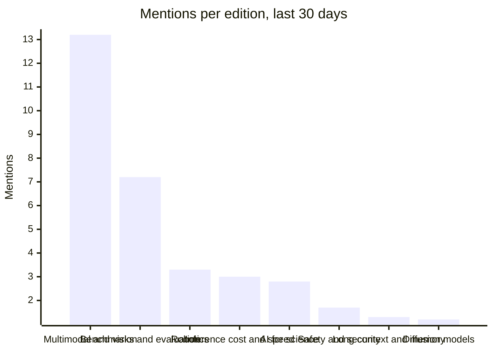

# AI Radar

What changed in AI, in plain words.

[Yesterday](../README.md) · [This week](week.md) · **This month**

## The last 30 days · Wed 28 Oct to Thu 26 Nov

### Stories with staying power

- **[microsoft/ML-For-Beginners](https://github.com/microsoft/ML-For-Beginners)** 12-week, 26-lesson classic ML curriculum with 52 quizzes. · 4 editions, first seen Sun 1 Nov
- **[secemp9/arxiv-complete](https://huggingface.co/datasets/secemp9/arxiv-complete)** A large-scale arXiv dataset (100M–1B tokens, Parquet) tagged for text generation and retrieval tasks. · 5 editions, first seen Sat 31 Oct
- **[WeVisOne-VL](https://arxiv.org/abs/2610.31329)** Unified VLM for object- and pixel-level perception (detection, segmentation, OCR, counting, matting). · 5 editions, first seen Wed 28 Oct
- **[Intrinsic Distribution Matching](https://arxiv.org/abs/2610.39633)** decomposes reverse-KL into Gaussian moment component and non-Gaussian residual; improves few-step text-to-image generation. · 4 editions, first seen Fri 30 Oct
- **[Looking Ahead](https://arxiv.org/abs/2610.29989)** Future Chunk Prediction auxiliary task for autoregressive video diffusion; improves modeling of scene evolution. · 4 editions, first seen Wed 28 Oct
- **[Vyber07/cyber-security](https://huggingface.co/datasets/Vyber07/cyber-security)** Text-generation/qa dataset (Apache-2.0, <1k examples). · 3 editions, first seen Fri 6 Nov

### Where attention moved

How often each topic came up per daily edition, this month against the month before (29 editions against 22). Counted from the digests' wording, so read it as direction, not exact size.

| Topic | Last 30 days | Before | Trend |
|---|---:|---:|---|
| Long context and memory | 1.3 | 4.6 | Down 71% |
| Safety and security | 1.7 | 0.5 | Up 2.9x |
| AI for science | 2.8 | 1.3 | Up 2.1x |
| Benchmarks and evaluation | 7.2 | 14.4 | Down 49% |
| Diffusion models | 1.2 | 2.2 | Down 42% |
| Robotics | 3.3 | 1.9 | Up 1.7x |
| Inference cost and speed | 3.0 | 4.5 | Down 34% |
| Multimodal and vision | 13.2 | 18.6 | Steady |

[All 29 editions this month, and every one before](README.md)
