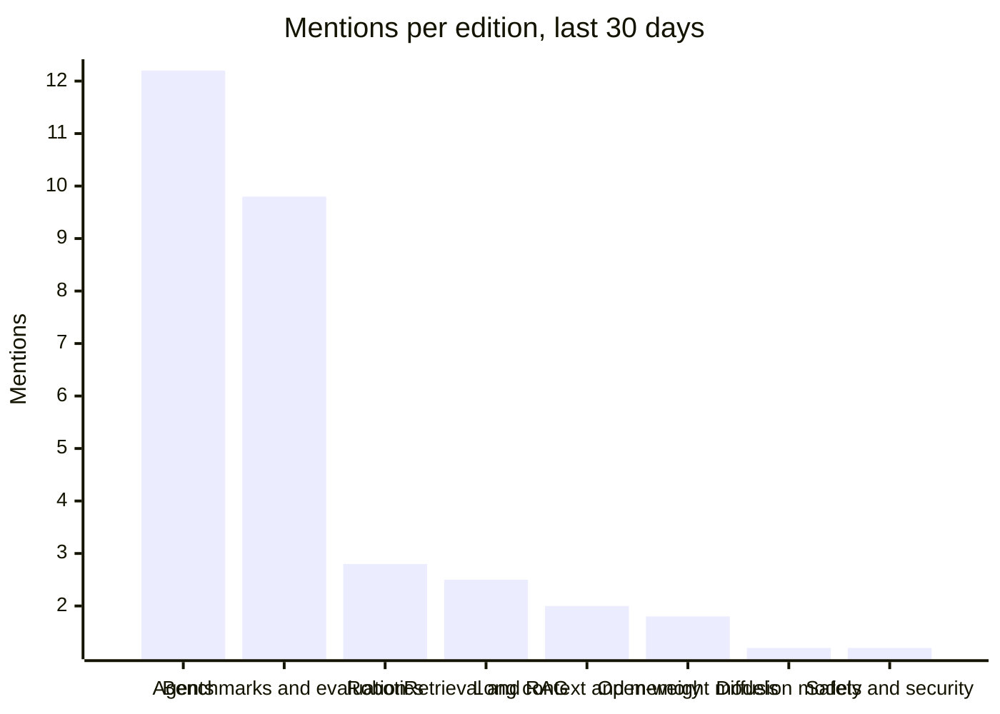

# AI Radar

What changed in AI, in plain words.

[Yesterday](../README.md) · [This week](week.md) · **This month**

## The last 30 days · Wed 14 Oct to Thu 12 Nov

### Stories with staying power

- **[nvidia/simready-assets (HF Dataset)](https://huggingface.co/datasets/nvidia/simready-assets)** CC-BY-4.0 simulation-ready 3D assets with 625k downloads; useful for robotics and synthetic data pipelines. · 14 editions, first seen Tue 27 Oct
- **[huggingface/transformers](https://github.com/huggingface/transformers)** Core model-definition framework for text, vision, audio, and multimodal models; 168k stars observed. · 14 editions, first seen Sat 24 Oct
- **[Qwen/Qwen3.8-27B](https://huggingface.co/Qwen/Qwen3.8-27B)** Image-text-to-text model (Qwen3.5 series); 18k likes, 7.85M downloads observed. · 15 editions, first seen Sat 24 Oct
- **[deepseek-ai/DeepSeek-V4.1-Flash-1017 (HF Model)](https://huggingface.co/deepseek-ai/DeepSeek-V4.1-Flash-1017)** image-text-to-text model (MIT) with 105k downloads; recent release for fast multimodal inference. · 11 editions, first seen Tue 27 Oct
- **[LocalLLaMA/typed-decisions](https://huggingface.co/datasets/LocalLLaMA/typed-decisions)** Benchmark dataset for text-classification evaluation with official YAML specs; 245 likes, 45k downloads observed. · 4 editions, first seen Sat 24 Oct
- **[microsoft/ML-For-Beginners](https://github.com/microsoft/ML-For-Beginners)** 12-week, 26-lesson classic ML curriculum with 52 quizzes. · 4 editions, first seen Sun 1 Nov

### Where attention moved

How often each topic came up per daily edition, this month against the month before (24 editions against 25). Counted from the digests' wording, so read it as direction, not exact size.

| Topic | Last 30 days | Before | Trend |
|---|---:|---:|---|
| Open-weight models | 1.8 | 0.5 | Up 3.3x |
| Diffusion models | 1.2 | 3.2 | Down 60% |
| Safety and security | 1.2 | 0.5 | Up 2.3x |
| Robotics | 2.8 | 1.2 | Up 2.2x |
| Long context and memory | 2.0 | 4.1 | Down 49% |
| Retrieval and RAG | 2.5 | 1.6 | Up 1.6x |
| Agents | 12.2 | 15.6 | Steady |
| Benchmarks and evaluation | 9.8 | 12.3 | Steady |

[All 24 editions this month, and every one before](README.md)
